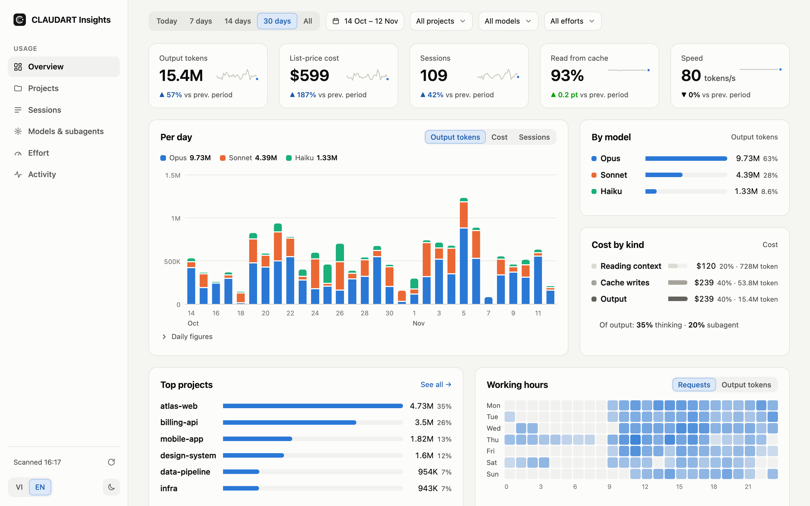
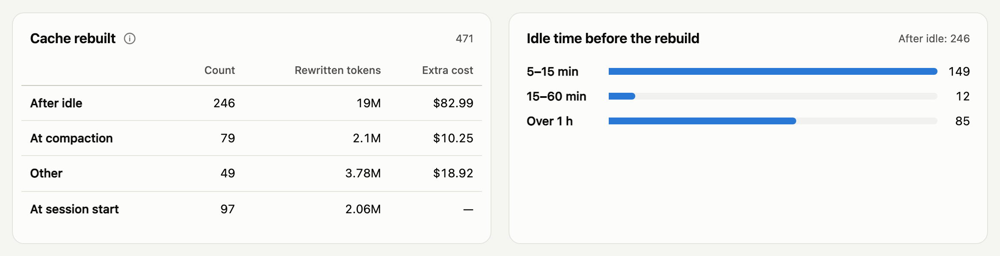
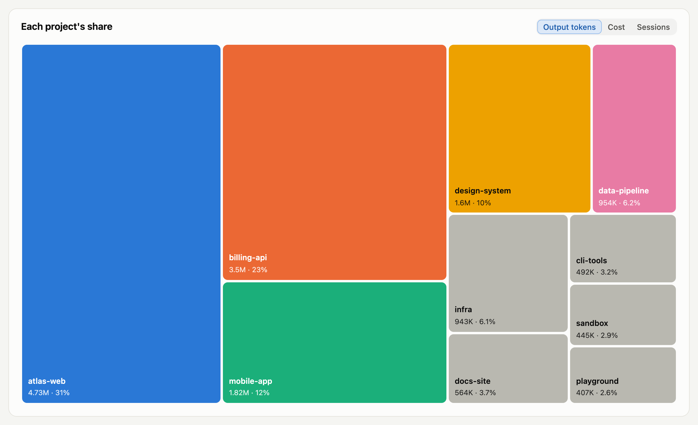
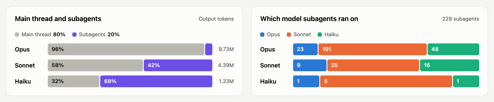
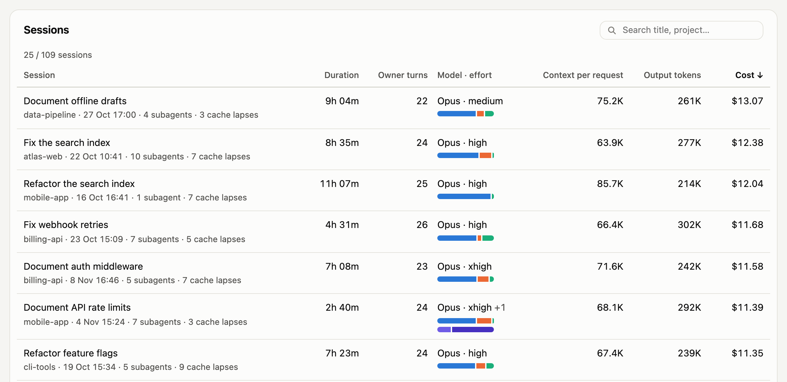

<p align="center"></p>

<h1 align="center">CLAUDART Insights</h1>

<p align="center">See where your Claude Code tokens and money go, on your own machine.</p>

<p align="center"><a href="README_VI.md">Tiếng Việt</a> · <a href="CONTRIBUTING.md">Contributing</a></p>

<picture>
  <source media="(prefers-color-scheme: dark)" srcset="docs/assets/overview-dark.png">
  
</picture>

<p align="center"><sub>Every figure on this page is made-up demo data, served by <code>make demo</code>.</sub></p>

Insights archives the transcripts Claude Code keeps in `~/.claude/projects`, reads them into SQLite and prices every request. Six views answer what the totals hide: which project costs the most, which sessions ran long, which model and subagent did the work, and when the prompt cache was rebuilt for nothing.

Nothing leaves your machine. The server listens on `127.0.0.1` only, and neither the server nor the page makes a network request.

## What it shows

### Cache rebuilds

What each rebuild of the prompt cache cost, and why it happened: a new session, a compaction or a break longer than the cache lives.

<picture>
  <source media="(prefers-color-scheme: dark)" srcset="docs/assets/cache-dark.png">
  
</picture>

### Projects

One tile per repository, sized by cost.

<picture>
  <source media="(prefers-color-scheme: dark)" srcset="docs/assets/treemap-dark.png">
  
</picture>

### Models and subagents

How the work splits between models, and between the agents a session delegates to.

<picture>
  <source media="(prefers-color-scheme: dark)" srcset="docs/assets/models-dark.png">
  
</picture>

### Sessions

Every conversation with its title, length, cost and model, sortable.

<picture>
  <source media="(prefers-color-scheme: dark)" srcset="docs/assets/sessions-dark.png">
  
</picture>

## Quick start

Node.js 25 or newer.

```bash
git clone https://github.com/vankhaivn/claudart-insights.git
cd claudart-insights
make start
```

`make start` returns once the server is up and leaves it running in the background; `make stop` ends it. Open <http://localhost:4310>. The first visit scans your transcripts into `data/`; the refresh button at the foot of the sidebar scans again. Without `make`, run `npm install` then `npm start`, which serves in the foreground until Ctrl+C.

To look around before pointing it at your own data, `make demo` serves ten weeks of made-up use at <http://localhost:4311>.

## Commands

| `make` target | CLI equivalent | What it does |
| --- | --- | --- |
| `make start` | `npm start` | Build the dashboard and serve it in the background; its output goes to `data/serve.log` |
| `make stop` | | Stop the dashboard `make start` runs |
| `make dev` | `npm run dev` | Serve the dashboard with hot reload, in the foreground |
| `make demo` | `node test/fixtures/demo.mjs` | Serve made-up data on port 4311 |
| `make scan` | `node bin/insights.mjs scan` | Archive new transcript lines and read them in |
| `make usage DAYS=30 BY=model` | `node bin/insights.mjs usage --days 30 --by model` | Tokens and cost in the terminal; `ARGS="..."` adds any other option |
| `make prices` | `node bin/insights.mjs prices` | Check the price table against Claude Code's cost records |

`make` alone lists the targets. The full CLI:

```text
node bin/insights.mjs scan                  archive new transcript lines and ingest them
node bin/insights.mjs show <session>:<line> print one archived record
node bin/insights.mjs usage [--days n | --since d --until d] [--by day|model|effort|project|session|hour|tool|skill|subagent]
                            [--project name] [--model family] [--effort level]
node bin/insights.mjs prices                the price table checked against Claude Code's own cost records
node bin/insights.mjs serve [--port n]      the built dashboard on http://localhost:<port>
```

Listing commands accept `--json`. For one window and one set of filters, `usage` and the dashboard report the same totals.

## How it works

<details>
<summary><b>Where data lives</b></summary>

```text
data/
├── archive/claude/   copy of the projects folder, append-only, line numbers stable
└── usage.db          rebuilt from the archive whenever its schema changes
```

The archive keeps a transcript even after Claude Code deletes it. `data/` is ignored by Git; delete `usage.db` at any time and the next scan rebuilds it.

A session's project is the nearest folder at or above its working directory that holds `.git`; without one, the folder's own name.

</details>

<details>
<summary><b>How cost is computed</b></summary>

Claude Code records a cost per session; Insights uses that figure and spreads it over the session's requests by their tokens priced on their own day from [prices.md](prices.md) (USD per million tokens, one row per model and start date). A session without a cost record is estimated from the table and marked as such. `prices` and the scan report show where Claude Code's figures and the table disagree; add a row from the day a price changes and never edit an old row.

Cost is list price. On a subscription it is quota spent, not money.

</details>

<details>
<summary><b>Cache rebuilds</b></summary>

Claude Code keeps your conversation in a prompt cache, so most input tokens are cheap reads. What costs money is a rebuild: a request that writes most of the context into the cache again, 25 to 40 times the price of reading it. A request is a rebuild when it writes at least 20,000 tokens to the cache and more than half of everything it read or wrote. The Activity view and `usage` count them per cause:

| Cause | Meaning |
| --- | --- |
| At session start | The first request of a thread (the main conversation, or one subagent). Unavoidable |
| At compaction | A compaction happened since the thread's previous request |
| After idle | The gap since the thread's previous request is longer than the cache lives: 1 hour if the thread's latest cache write included 1h cache, otherwise 5 minutes. Split into 5 to 15 minutes, 15 to 60 minutes and over an hour |
| Other | Anything else |

The extra cost of a rebuild is the rewritten tokens priced as cache writes (5m and 1h as recorded) minus the same tokens priced as reads, from the price row in force that day. The Sessions view's "Cache lapses" column counts the idle rebuilds in each session.

`other` cannot be explained from transcripts. The 20,000-token and one-half thresholds are a fixed convention, not something Claude Code reports. A model without a price row has no extra cost, and its rebuilds are counted without one.

</details>

<details>
<summary><b>Skills</b></summary>

The Activity view and `usage --by skill` count each skill by name: the times you typed it as a slash command and the times the agent called it on its own, with the calls that failed. A slash command counts only when Claude Code loads a skill for it, so built-in commands such as `/compact` are left out. Each skill is listed under where Claude Code loaded it from:

| Source | Folder |
| --- | --- |
| Project | `.claude/skills/` in a repository |
| Personal | `~/.claude/skills/` |
| Plugin | an installed plugin; its skills are named `plugin:skill` |
| Built-in | the skills bundled with Claude Code |
| Other | a folder that matches none of these, or a skill whose folder no transcript records |

</details>

<details>
<summary><b>Config (optional)</b></summary>

Copy `insights.config.example.json` to `insights.config.json` in the repository root. Every key is optional; `INSIGHTS_CONFIG` points at a config file elsewhere.

| Key | Default | Meaning |
| --- | --- | --- |
| `providers` | `{ "claude": { "transcripts": "~/.claude/projects" } }` | The transcript sources to read; `claude` is the only one known, and any other name is an error |
| `data` | `data` | Where the archive and database live, relative to the config file |
| `port` | `4310` | Dashboard port |
| `timeZone` | the system time zone | Decides which day and hour a request belongs to |
| `prices` | `prices.md` in this repository | The price table |

</details>

## Development

```bash
make test
make check
make build
```

Tests, the dashboard type-check and the dashboard build. Tests use synthetic transcripts in temp folders only. [CONTRIBUTING.md](CONTRIBUTING.md) covers Issues, branches, commits and pull requests; [CLAUDE.md](CLAUDE.md) guides a coding agent working on a fork.

## License

MIT
