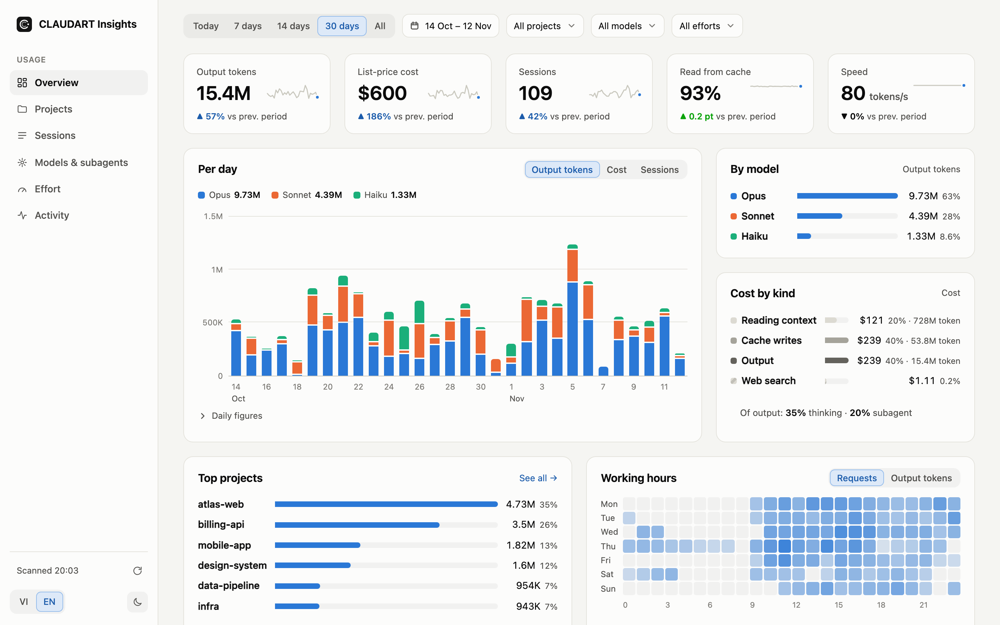
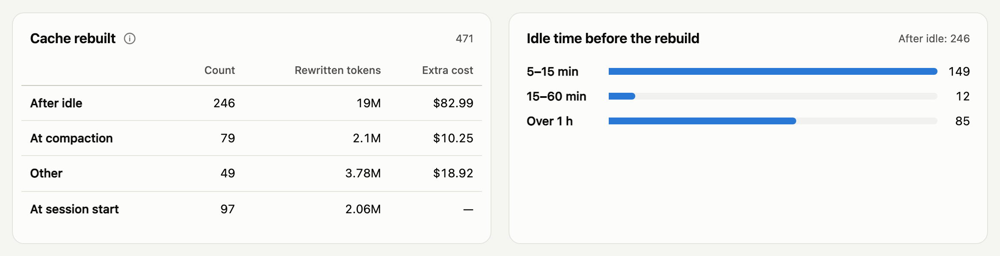
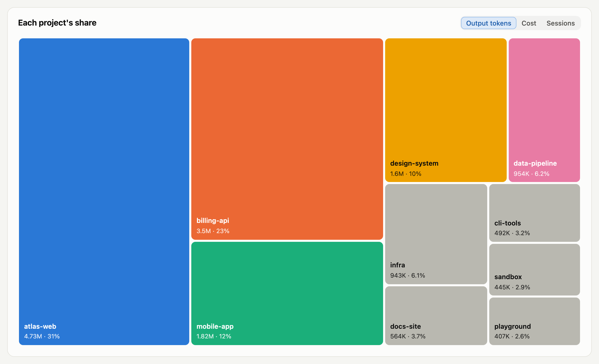
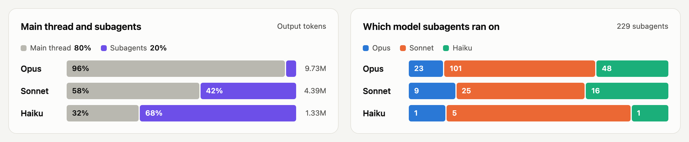
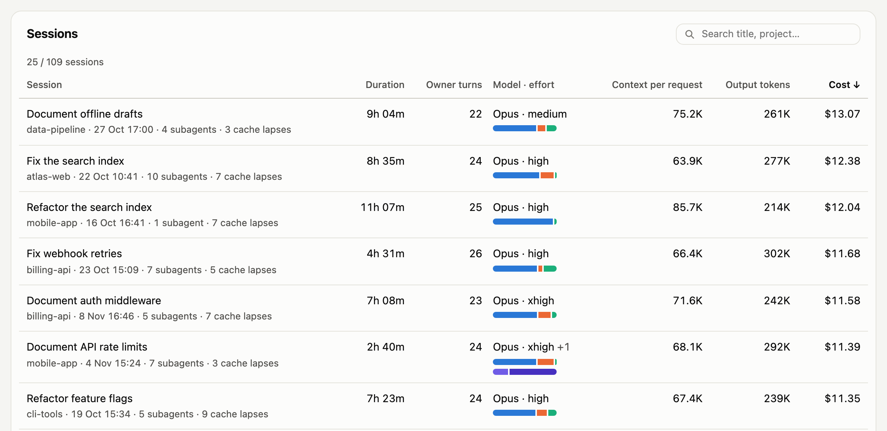

<p align="center"></p>

<h1 align="center">CLAUDART Insights</h1>

<p align="center">Xem token và tiền Claude Code của bạn đi đâu, ngay trên máy bạn.</p>

<p align="center"><a href="README.md">English</a> · <a href="CONTRIBUTING.md">Contributing</a></p>

<picture>
  <source media="(prefers-color-scheme: dark)" srcset="docs/assets/overview-dark.png">
  
</picture>

<p align="center"><sub>Mọi con số trên trang này là dữ liệu demo bịa ra, do <code>make demo</code> phục vụ.</sub></p>

Insights lưu trữ transcript mà Claude Code giữ trong `~/.claude/projects`, nạp vào SQLite và tính giá từng request. Sáu màn hình trả lời những gì con số tổng che đi: dự án nào tốn nhất, phiên nào kéo dài, model và subagent nào làm phần việc, và lúc nào prompt cache bị dựng lại vô ích.

Không có gì rời khỏi máy bạn. Server chỉ lắng nghe trên `127.0.0.1`, server và trang web đều không gửi request ra ngoài.

## Bạn thấy được gì

### Cache bị dựng lại

Mỗi lần prompt cache bị dựng lại tốn bao nhiêu và vì sao: phiên mới, nén context, hay nghỉ lâu hơn tuổi thọ của cache.

<picture>
  <source media="(prefers-color-scheme: dark)" srcset="docs/assets/cache-dark.png">
  
</picture>

### Dự án

Mỗi repository một ô, lớn nhỏ theo chi phí.

<picture>
  <source media="(prefers-color-scheme: dark)" srcset="docs/assets/treemap-dark.png">
  
</picture>

### Model và subagent

Phần việc chia giữa các model, và giữa các agent mà phiên giao việc cho.

<picture>
  <source media="(prefers-color-scheme: dark)" srcset="docs/assets/models-dark.png">
  
</picture>

### Phiên làm việc

Mọi cuộc trò chuyện với tiêu đề, thời lượng, chi phí và model, sắp xếp được.

<picture>
  <source media="(prefers-color-scheme: dark)" srcset="docs/assets/sessions-dark.png">
  
</picture>

## Bắt đầu nhanh

Node.js 25 trở lên.

```bash
git clone https://github.com/vankhaivn/claudart-insights.git
cd claudart-insights
make start
```

`make start` trả lại terminal khi server đã chạy và để nó chạy nền; `make stop` tắt nó. Mở <http://localhost:4310>. Lần mở đầu tiên quét transcript vào `data/`; nút làm mới ở chân sidebar quét lại. Máy không có `make` thì chạy `npm install` rồi `npm start`, chạy foreground tới khi Ctrl+C.

Muốn xem thử trước khi dùng dữ liệu của mình, `make demo` phục vụ mười tuần dữ liệu bịa ra tại <http://localhost:4311>.

## Lệnh

| Target `make` | Lệnh CLI tương ứng | Việc làm |
| --- | --- | --- |
| `make start` | `npm start` | Build dashboard và phục vụ nó ở nền; output ghi vào `data/serve.log` |
| `make stop` | | Tắt dashboard mà `make start` chạy |
| `make dev` | `npm run dev` | Phục vụ dashboard có hot reload, ở foreground |
| `make demo` | `node test/fixtures/demo.mjs` | Phục vụ dữ liệu bịa ra ở cổng 4311 |
| `make scan` | `node bin/insights.mjs scan` | Lưu các dòng transcript mới và nạp vào |
| `make usage DAYS=30 BY=model` | `node bin/insights.mjs usage --days 30 --by model` | Token và chi phí trên terminal; `ARGS="..."` thêm option khác |
| `make prices` | `node bin/insights.mjs prices` | Đối chiếu bảng giá với bản ghi chi phí của Claude Code |

Chạy `make` không kèm gì để liệt kê các target. CLI đầy đủ:

```text
node bin/insights.mjs scan                  lưu trữ các dòng transcript mới và nạp vào database
node bin/insights.mjs show <session>:<line> in một bản ghi đã lưu
node bin/insights.mjs usage [--days n | --since d --until d] [--by day|model|effort|project|session|hour|tool|skill|subagent]
                            [--project name] [--model family] [--effort level]
node bin/insights.mjs prices                bảng giá đối chiếu với bản ghi chi phí của Claude Code
node bin/insights.mjs serve [--port n]      dashboard đã build tại http://localhost:<port>
```

Các lệnh dạng danh sách nhận `--json`. Với cùng một khoảng ngày và bộ lọc, `usage` và dashboard cho cùng số tổng.

## Cách hoạt động

<details>
<summary><b>Dữ liệu nằm ở đâu</b></summary>

```text
data/
├── archive/claude/   bản sao thư mục projects, chỉ thêm vào, số dòng cố định
└── usage.db          dựng lại từ archive mỗi khi schema đổi
```

Archive vẫn giữ transcript sau khi Claude Code xoá nó. `data/` bị Git bỏ qua; xoá `usage.db` lúc nào cũng được, lần quét sau sẽ dựng lại.

Dự án của một phiên là thư mục gần nhất, từ thư mục làm việc trở lên, có `.git`; không có thì lấy tên chính thư mục đó.

</details>

<details>
<summary><b>Chi phí được tính thế nào</b></summary>

Claude Code ghi chi phí cho mỗi phiên; Insights dùng con số đó và chia cho các request của phiên theo token, tính giá của chính ngày hôm đó trong [prices.md](prices.md) (USD cho một triệu token, mỗi dòng ứng với một model và ngày bắt đầu hiệu lực). Phiên không có bản ghi chi phí được ước tính từ bảng giá và được đánh dấu. `prices` và báo cáo của lần quét cho biết chỗ số của Claude Code lệch bảng giá; hãy thêm dòng mới từ ngày giá đổi, đừng sửa dòng cũ.

Mỗi khoản chi phí được tách theo thứ nó trả cho: đọc context, ghi cache, output và web search. Claude Code còn gọi model ngầm, trong đó có Haiku cho công cụ WebSearch, mà không ghi các lần gọi đó vào transcript; chi phí của chúng được tách theo số token Claude Code đã ghi cho model đó. Web search là phần một model có tìm kiếm web tốn thêm ngoài số token của nó tính theo bảng giá. Model chưa có dòng giá thì giữ nguyên là "Không tách được".

Chi phí tính theo giá niêm yết. Với gói thuê bao, đó là hạn mức đã dùng, không phải tiền.

</details>

<details>
<summary><b>Cache bị dựng lại</b></summary>

Claude Code giữ cuộc trò chuyện trong prompt cache, nên phần lớn input token là lần đọc rẻ. Thứ tốn tiền là lần dựng lại: một request ghi phần lớn context vào cache lần nữa, đắt gấp 25 đến 40 lần đọc cache. Một request được tính là dựng lại khi ghi ít nhất 20.000 token vào cache và hơn một nửa tổng số token nó đọc hoặc ghi. Màn hình Hoạt động và lệnh `usage` đếm theo từng nguyên nhân:

| Nguyên nhân | Ý nghĩa |
| --- | --- |
| Đầu phiên | Request đầu tiên của một luồng (cuộc trò chuyện chính hoặc một subagent). Không tránh được |
| Khi nén context | Có một lần nén context kể từ request trước của luồng |
| Sau khi nghỉ | Khoảng cách từ request trước của luồng dài hơn tuổi thọ của cache: 1 giờ nếu lần ghi cache gần nhất của luồng có cache 1h, nếu không thì 5 phút. Chia thành 5 đến 15 phút, 15 đến 60 phút và trên 1 giờ |
| Khác | Mọi trường hợp còn lại |

Chi phí thêm của một lần dựng lại là số token được ghi lại tính theo giá ghi cache (5m và 1h như đã ghi nhận) trừ đi chính số token đó tính theo giá đọc cache, theo dòng giá hiệu lực trong ngày. Màn hình Phiên làm việc ghi số lần dựng lại sau khi nghỉ của mỗi phiên, là số lần cache hết hạn, dưới tiêu đề phiên.

Không thể giải thích `khác` từ transcript. Ngưỡng 20.000 token và một nửa là quy ước cố định, không phải số Claude Code báo. Model không có dòng giá thì không có chi phí thêm, nhưng lần dựng lại vẫn được đếm.

</details>

<details>
<summary><b>Skill</b></summary>

Màn hình Hoạt động và lệnh `usage --by skill` đếm từng skill theo tên: số lần bạn gõ nó thành slash command và số lần agent tự gọi, kèm số lần gọi lỗi. Một slash command chỉ được tính khi Claude Code nạp một skill cho nó, nên lệnh có sẵn như `/compact` không được tính. Mỗi skill được xếp theo nơi Claude Code nạp nó:

| Nguồn | Thư mục |
| --- | --- |
| Project | `.claude/skills/` trong một repository |
| Cá nhân | `~/.claude/skills/` |
| Plugin | một plugin đã cài; skill của nó có tên `plugin:skill` |
| Có sẵn | skill đi kèm Claude Code |
| Khác | thư mục không thuộc các loại trên, hoặc skill không transcript nào ghi thư mục |

</details>

<details>
<summary><b>Cấu hình (tuỳ chọn)</b></summary>

Sao chép `insights.config.example.json` thành `insights.config.json` ở thư mục gốc repo. Mọi key đều tuỳ chọn; biến `INSIGHTS_CONFIG` trỏ tới file config ở chỗ khác.

| Key | Mặc định | Ý nghĩa |
| --- | --- | --- |
| `providers` | `{ "claude": { "transcripts": "~/.claude/projects" } }` | Các nguồn transcript cần đọc; hiện chỉ biết `claude`, tên khác sẽ báo lỗi |
| `data` | `data` | Nơi chứa archive và database, tính từ vị trí file config |
| `port` | `4310` | Cổng dashboard |
| `timeZone` | múi giờ của hệ thống | Quyết định request thuộc ngày và giờ nào |
| `prices` | `prices.md` trong repo | Bảng giá |

</details>

## Phát triển

```bash
make test
make check
make build
```

Test, kiểm tra kiểu cho dashboard và build dashboard. Test chỉ dùng transcript tổng hợp trong thư mục tạm. [CONTRIBUTING.md](CONTRIBUTING.md) mô tả Issue, branch, commit và pull request; [CLAUDE.md](CLAUDE.md) hướng dẫn coding agent làm việc trên bản fork.

## Giấy phép

MIT
